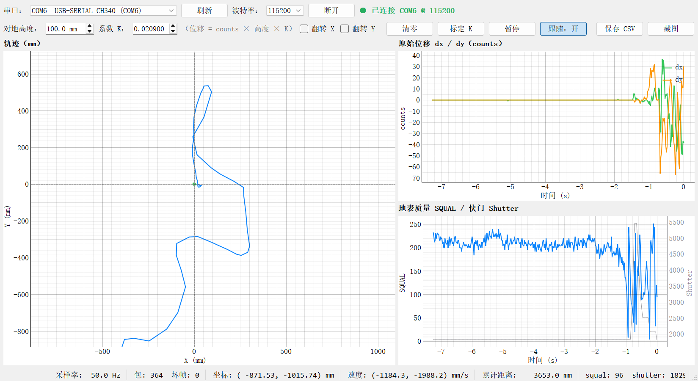
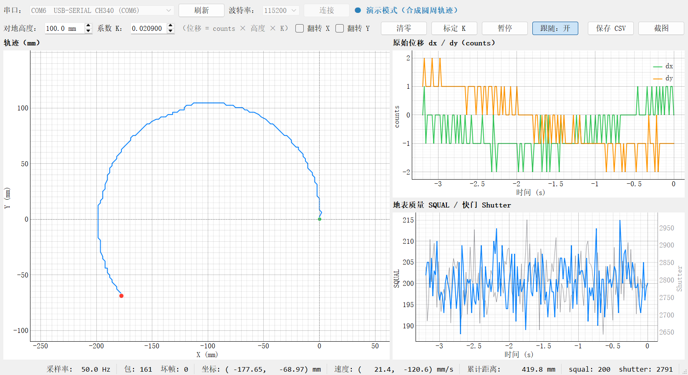

# PMW3901 光流传感器测试（ESP32-S3 / ESP-IDF v5.5.3）

> ESP32-S3 + PMW3901 optical-flow driver (ESP-IDF) with a PyQt5 real-time trajectory host app.

一句话：这是一个**在 ESP32-S3 上跑通逐飞科技 PMW3901 光流模块**的 ESP-IDF 工程——底层 SPI 驱动 + 初始化序列 + 50Hz 结构化数据帧，配套一个 PyQt5 实时轨迹上位机。

> 状态：**固件 + 上位机均已在实机联调通过**
> - `idf.py build` 0 warning / 0 error；bin 245,456 字节（0x3bed0），1MB app 分区剩 77%；
> - 传感器：`chip id: 0x49 / 0xB6`、`init done`；`squal` 约 170~210（木纹桌面），`shutter` 稳定在 2830 附近；
> - 上位机实机 8 秒：`packets=364 bad=0 rate=50.0Hz`，CSV 364 行，移动模块时轨迹跟随；
> - 离线自检（不需要硬件）：`SELFTEST_OK samples=525 rate=50.0Hz csv_rows=525`；
> - 板子：Flash 16MB（boya 颗粒，`Detected size(16384k)`），CH340 → COM6。

| 实机运行（COM6） | 演示模式（`--demo`） |
|---|---|
|  |  |

> 左：接实机采集 8 秒的截图，状态栏 `采样率 50.0Hz / 包 364 / 坏帧 0`。右：不接板子、用合成圆周数据跑出来的界面。

---

## Features

- **PMW3901 驱动封装成独立组件**：`components/pmw3901/` 可以直接拷到别的工程复用，对外 API 只有 7 个；
- **严格按数据手册的 SPI 时序**：SPI mode 3、2MHz、GPIO 手动片选（满足 tSRAD ≥ 35us 与 CS 全程拉低）；
- **motion burst 原子读取**：一次 transaction 读 12 字节，dx/dy/squal/shutter 来自同一时刻，不会出现高低字节错位；
- **结构化数据帧 `$FLOW`**：50Hz 输出带 XOR 校验的 ASCII 行，方便上位机稳定解析，同时保留人类可读日志（1s 一条）；
- **自检与容错**：ID 反码校验、冷启动首读失败自动重试 5 次、初始化失败每 2s 重试并打印排查提示；
- **配套上位机**：PyQt5 实时 2D 轨迹（mm）+ dx/dy 曲线 + SQUAL/Shutter 双 Y 轴 + 状态栏，支持高度/K、翻转、清零、暂停、视图跟随、CSV/截图导出、按已知距离自动标定 K；
- **三层自检**：协议解析自检 → 离线出图自检（不需要硬件）→ `--capture N` 实机抓包统计，方便改完代码做回归；
- **板级适配简单**：换引脚/换 SPI 主机只改头文件里 5 个宏。

---

## 硬件

### 接线（默认配置）

默认用 ESP32-S3 的 **SPI2（FSPI）默认引脚**，正点原子 DNESP32S3 等开发板排针上都引出了：

| PMW3901 模块 | ESP32-S3 | 说明 |
|---|---|---|
| VCC | 3V3 | 模块标注 5V 输入就接 5V（板载 LDO），**二选一，别同时接** |
| GND | GND | 必须共地 |
| SCK / SCL | GPIO12 | SPI 时钟 |
| MOSI / SDA | GPIO11 | 主出从入 |
| MISO / ADR | GPIO13 | 主入从出 |
| CS / CSN | GPIO10 | 片选，低有效 |
| MOT（如有） | 不接 | 运动指示引脚，本工程用轮询，不需要 |

注意事项：

- 逻辑电平 **3.3V**，不要用 5V 电平的 SPI；
- 杜邦线尽量短（<15cm），长了先把 SPI 时钟从 2MHz 降到 1MHz；
- 模块镜头**朝下**，离地 8cm 以上、地面有纹理（木地板/桌布/打印的格子纸都行），纯白墙/玻璃/镜面读不到；
- **别和 LCD 抢 SPI2**：很多例程里 LCD 也占 GPIO11/12/13，同时用时要么换引脚，要么把 LCD 和 PMW3901 挂同一条 SPI 总线。

### 改引脚 / 改 SPI 主机

只改 `components/pmw3901/include/pmw3901.h` 顶部这 5 个宏即可（或者自己在 `main.c` 里填 `pmw3901_config_t` 结构体）：

```c
#define PMW3901_DEFAULT_HOST        SPI2_HOST
#define PMW3901_DEFAULT_PIN_SCLK    GPIO_NUM_12
#define PMW3901_DEFAULT_PIN_MOSI    GPIO_NUM_11
#define PMW3901_DEFAULT_PIN_MISO    GPIO_NUM_13
#define PMW3901_DEFAULT_PIN_CS      GPIO_NUM_10
#define PMW3901_DEFAULT_CLOCK_HZ    2000000
```

---

## 目录结构

```
18_pmw3901_flow/
├── CMakeLists.txt                 工程根
├── sdkconfig.defaults             Flash 16MB（实测板子就是 16MB）、FreeRTOS tick 1ms、日志 INFO
├── .gitignore                     排除 build/、sdkconfig、host/.venv、__pycache__ 等
├── components/
│   └── pmw3901/                   驱动组件（可直接拷到别的工程复用）
│       ├── include/pmw3901.h      引脚/配置/API/换算系数
│       └── pmw3901.c              SPI 时序、初始化序列、读运动数据
├── main/
│   ├── CMakeLists.txt
│   └── main.c                     测试主程序：50Hz 采集 + $FLOW 数据帧 + 串口日志
├── host/                          上位机（PyQt5 + pyqtgraph）
│   ├── flow_host.py               单文件约 890 行：串口线程 + 轨迹/曲线 + 标定/导出
│   ├── requirements.txt           依赖清单
│   ├── run_host.bat               一键启动（首次运行自动建 venv 装依赖）
│   ├── capture_real.png/.csv      实机联调 8 秒的截图与数据
│   ├── demo_capture.png/.csv      演示模式的截图与数据
│   └── selftest.png/.csv          离线自检的截图与数据
├── docs/
│   └── blog-draft.md              CSDN 文章初稿（截图占位待补）
├── LICENSE                        MIT
└── README.md
```

---

## 快速开始

### 1. 编译与烧录（固件）

ESP-IDF 版本：**v5.5.3**，目标芯片 **esp32s3**，串口 **115200**。

方式 A：VS Code + ESP-IDF 插件（推荐，日常最省事）

1. VS Code 打开本文件夹；
2. 底部状态栏选择目标芯片 **esp32s3**、串口 COMx；
3. Build → Flash → Monitor。

方式 B：开始菜单里的 "ESP-IDF 5.5 CMD"

```bat
cd /d <你的工程目录>
idf.py set-target esp32s3
idf.py build
idf.py -p COMx flash monitor
```

> 本机 `export.ps1` 有个坑：它硬找 `python_env\idf5.5_py3.12_env`，而实际安装的是 `idf5.5_py3.11_env`，所以 PowerShell 里 export 会失败。日常直接用 VS Code 插件或开始菜单的 ESP-IDF CMD 即可。
> 想在普通命令行里完全绕开 `export.ps1` 也可以，但不是一行命令能解决：需要先用 `idf_tools.py export` 把 `IDF_PATH` 和工具链 `PATH` 导入当前 shell，再调用 `%IDF_PATH%\tools\idf.py`。步骤较多，这里不展开。

### 2. 上位机（`host/`）

依赖版本（独立 venv 实测）：Python 3.12.13 + PyQt5 5.15.11 / pyqtgraph 0.14.0 / pyserial 3.5 / numpy 2.4.6，虚拟环境在 `host\.venv`。

**最省事**：双击 `host\run_host.bat`。首次运行会自动创建 venv 并安装依赖（需要联网），之后双击直接开界面。

**手动启动**：

```bat
cd host
python -m venv .venv
.venv\Scripts\python.exe -m pip install -r requirements.txt
.venv\Scripts\python.exe flow_host.py --port COM6
```

命令行参数：

| 参数 | 作用 |
|---|---|
| 无参数 | 打开界面，手动选串口 / 刷新 / 连接 |
| `--port COM6` | 启动后自动连接该串口 |
| `--demo` | 演示模式：合成圆周轨迹，不接板子也能看界面 |
| `--selftest out.png` | 离线自检：喂合成数据、出图后退出（不需要硬件） |
| `--capture 8 --shot out.png` | 连上后采 8 秒，自动截图 + 存 CSV + 打印统计再退出 |

界面功能：

- **轨迹（mm）**：pyqtgraph 等比例坐标，绿点起点、红点当前位置，支持视图跟随 / 暂停 / 清零；
- **原始位移 dx/dy（counts）**：10 秒滚动窗口；
- **SQUAL / Shutter 双 Y 轴**：快门是几千的量级、squal 只有两百，分轴显示才不会把 squal 压平；
- **状态栏**：采样率、包数、坏帧数、坐标、速度、累计距离、当前 squal/shutter；
- **参数栏**：对地高度、系数 K、翻转 X/Y、标定 K、保存 CSV、截图；
- **设置持久化**：高度 / K / 翻转 / 波特率下次启动自动恢复。

导出的 CSV 列：`t_ms, dx, dy, motion, squal, shutter, x_mm, y_mm`。

> 仓库根已有 `.gitignore`（已排除 `build/`、`sdkconfig`、`host/.venv`、`__pycache__` 等），克隆后直接开跑即可。

#### 用已知距离标定 K

1. 点【标定 K】打开对话框；
2. 点【开始记录】，记下当前累计 counts；
3. 沿直尺匀速推一段已知距离（比如 200mm），镜头始终朝下；
4. 填写实际距离，点【计算并应用】：`K = 距离 / (counts × 高度)`，算出的 K 写回界面并保存。

#### 验证记录（实测）

| 项目 | 方法 | 结果 |
|---|---|---|
| 协议解析 | 内置自检 | `PROTOCOL_SELFTEST_OK`：正常帧通过，校验错 / 垃圾数据被拒 |
| 离线自检 | `--selftest out.png` | `SELFTEST_OK samples=525 rate=50.0Hz csv_rows=525` |
| 串口直读 4 秒 | 统计串口输出 | `OK_FRAMES=186 BAD=0 ESP_LOG_LINES=67`（≈47Hz，日志行被正确忽略） |
| 实机上位机 8 秒 | `--port COM6 --capture 8 --shot capture_real.png` | `packets=364 bad=0 rate=50.0Hz`，CSV 364 行 |
| 演示模式 5 秒 | `--demo --capture 5` | `packets=161 bad=0 rate=50.0Hz` |

---

## 正常输出长什么样

上电后（下面是实机抓的一段，`motion` 帧数会随移动增长）：

```
I (284) FLOW: ================ PMW3901 optical flow test ================
I (285) FLOW: SPI: SCLK=12 MOSI=11 MISO=13 CS=10 clock=2000000 Hz
I (298) pmw3901: chip id: 0x00 / 0x00        <- 刚上电第一次可能读不到，驱动会自动重试
I (319) pmw3901: chip id: 0x49 / 0xB6
I (545) pmw3901: init done
I (545) FLOW: sensor ready (chip id already verified in init)
I (545) FLOW: sample=20 ms, height=100 mm, 1 count ~= 2.09 mm
I (765) FLOW: dx=  +0 dy=  +0 cnt | total=(+0,+0) | v=(+0.0,+0.0) mm/s | squal=196 shutter= 2830 | frames=10 motion=4
I (965) FLOW: dx=  +2 dy=  -1 cnt | total=(+2,-1) | v=(+52.2,-20.9) mm/s | squal=188 shutter= 2830 | frames=20 motion=11
I (1165) FLOW: dx=  -4 dy= -14 cnt | total=(-2,-15) | v=(-94.0,-177.6) mm/s | squal= 76 shutter= 2077 | frames=30 motion=20
```

### 结果判读

| 现象 | 含义 |
|---|---|
| `chip id: 0x49 / 0xB6` | SPI 通了，芯片正常，最难的坎过了 |
| 第一次 `chip id: 0x00 / 0x00` 后立刻重试成功 | 模块刚上电还没准备好，正常现象（驱动会重试 5 次） |
| `init failed: ESP_ERR_NOT_FOUND` | 通信不通：接线/供电/时钟太快/CS 不对，见「常见问题」 |
| `dx/dy` 随移动方向变化，`motion` 帧数在涨 | 光流数据正常 |
| `squal` 实机桌面/木纹约 170~210 | 地表质量 0~255；**长期 < 40** 说明纹理太差或太暗 |
| `shutter` 实机几千（稳定不跳） | 数值大说明环境暗；上限 0x1FFF（8191），贴到上限基本全黑/过曝 |
| `no motion detected in 5 s` | 镜头没朝下、地面没纹理、贴太近或太远 |
| `v` 只做趋势参考 | 用的是几何近似系数，**不是标定后的真实速度** |

---

## 数据协议：`$FLOW`

固件每帧（50Hz）单独输出一行 ASCII 数据。不是以 `$FLOW` 开头的行（例如 `ESP_LOG` 日志）按协议直接忽略。

```
$FLOW,<t_ms>,<dx>,<dy>,<motion>,<squal>,<shutter>*<XOR>\n
```

| 字段 | 类型 | 说明 |
|---|---|---|
| `$FLOW` | — | 帧头 |
| `t_ms` | int64 | 上电后毫秒数（`esp_timer_get_time()/1000`） |
| `dx` | int | 本帧水平位移，单位 counts，带符号 |
| `dy` | int | 本帧垂直位移，单位 counts，带符号 |
| `motion` | 0/1 | 本帧是否检测到运动（burst 字节 0 的 bit7） |
| `squal` | 0~255 | 地表质量（burst 的 `SQUAL/4 × 4`） |
| `shutter` | 0~8191 | 快门值（高字节只取低 5 位） |
| `XOR` | 2 位大写十六进制 | `$` 之后、`*` 之前所有 ASCII 字符异或 |

示例：

```
$FLOW,12345,+12,-3,1,196,2830*13
```

校验算法（Python）：

```python
def parse_flow(line: str):
    line = line.strip()
    if not line.startswith("$"):
        return None
    body, _, chk = line[1:].partition("*")
    x = 0
    for ch in body:
        x ^= ord(ch)
    if f"{x:02X}" != chk:
        return None                      # 校验失败，整帧丢弃
    name, t_ms, dx, dy, motion, squal, shutter = body.split(",")
    assert name == "FLOW"
    return dict(t_ms=int(t_ms), dx=int(dx), dy=int(dy), motion=int(motion),
                squal=int(squal), shutter=int(shutter))
```

> 带宽：50Hz × 每行约 40 字节 ≈ 2KB/s，115200 波特率（约 11.5KB/s）余量充足。

---

## 从 counts 到毫米：标定方法

PMW3901 输出的是 counts，不是毫米。物理关系是：

```
位移(mm) = counts × 对地高度 h(mm) × K
```

`K` 是**每像素对应的角度**（rad/count）。代码里给了一个几何近似值：

```c
#define PMW3901_COUNT_TO_RAD    0.0209f
```

来源：PMW3901 视场约 42°、35×35 像素，42° / 35 ≈ 1.2° ≈ 0.021 rad。在 h = 100mm 时，**1 count ≈ 2.09mm**，所以直尺平移 200mm 理论上约 96 counts（**这是理论值，不是实测结果**）。

**这个系数只能看趋势，不能当测距用**，因为镜头批次、地面纹理、实际安装高度都会影响它。正式使用建议实测标定：

1. 把模块固定在已知高度 h（比如 100mm），镜头朝下；
2. 沿直尺方向**匀速平移一段已知距离**（比如 200mm），记录累计 counts N；
3. 反算 `K = 位移 / (N × h)`；
4. 换几个高度重复，检查 K 是否稳定；不稳定说明高度/安装角有问题，或者地面纹理太差。

> 更进一步的方向：加 VL53L1X 之类的测高传感器实时修正 h，因为小车颠簸时对地高度不是常数。

---

## 驱动 API

`components/pmw3901/include/pmw3901.h`：

| 函数 | 作用 |
|---|---|
| `pmw3901_init(&cfg)` | 建 SPI 总线 + 片选、上电复位、校验 ID（失败自动重试 5 次）、写初始化寄存器 |
| `pmw3901_read_id(&id, &id_inv)` | 读 0x00 / 0x5F 自检 |
| `pmw3901_read_motion(&m)` | 读一次 12 字节 motion burst，原子得到 `motion/delta_x/delta_y/squal/shutter` |
| `pmw3901_read_reg / pmw3901_write_reg` | 单寄存器读写，调新功能时用 |
| `pmw3901_reset()` | 软复位 + 重写配置，运行中数据异常时可用 |
| `pmw3901_counts_to_mm(counts, height_mm)` | counts → 地面位移（几何近似） |

### 用到的寄存器

| 地址 | 名称 | 说明 |
|---|---|---|
| 0x00 / 0x5F | PRODUCT_ID / 反码 | 应读到 0x49 / 0xB6 |
| 0x02 | MOTION | 单寄存器运动标志（本驱动不用它判断，以 burst 为准） |
| 0x03~0x06 | DELTA_X/Y 低/高字节 | 16 位有符号，小端（分寄存器读法） |
| 0x07 | SQUAL | 地表质量 0~255 |
| 0x0B / 0x0C | SHUTTER 低/高字节 | 快门值（高字节取低 5 位） |
| 0x16 | MOTION_BURST | **本驱动主用**：连续读 12 字节，原子拿到 motion/dx/dy/squal/shutter |
| 0x3A | POWER_UP_RESET | 写 0x5A 软复位 |
| 0x7F | BANK_SELECT | 初始化序列里的 bank 切换 |

三个容易踩的点（前两个网上移植翻车最多，第三个是实机踩出来的）：

1. **写寄存器地址要 `| 0x80`，读寄存器地址最高位保持 0**；
2. 读操作发完地址后要等 **tSRAD（≥35us）** 再读数据，而且 CS 全程拉低。驱动里用 GPIO 手动控制 CS 就是为了这个；
3. **运动标志在 0x16 burst 的字节 0 的 bit7**，不是 0x02 的 bit0；分寄存器读快门会高低字节错位乱跳，用 burst 一次读 12 字节最稳。

### 关键时序参数（`pmw3901.c`）

| 宏 | 值 | 依据 |
|---|---|---|
| `PMW3901_T_CS_SETUP_US` | 50us | CS 拉低到第一个时钟沿 |
| `PMW3901_T_SRAD_US` | 50us | 发读地址 → 读数据，手册要求 ≥35us |
| `PMW3901_T_CS_HOLD_US` | 50us | 最后一个时钟沿到 CS 拉高 |
| `PMW3901_T_SWW_US` | 200us | 连续两次写之间，手册要求 ≥180us |

---

## 常见问题

**烧录时报 `Could not open COM6, the port is busy or doesn't exist.`**

- 串口 CH340 被别的程序占用。本机曾遇到过自写的一个会自动连串口的小工具（T-Display 电脑状态监视）抢先占用 COM6，先结束它再烧；
- 其他可能：串口助手、VS Code 串口监视器、OpenMV/上位机等占用串口。

**ID 读不到（`0x00` 不是 0x49，且重试一直失败）**

1. VCC/GND 是否接对、模块是否发热（发热多半是电源接反或 5V/3V3 同时接）；
2. MISO/MOSI 是否接反（很多人把模块 SDA 当 MISO 接）；
3. CS 是否接对、是否被别的外设占了；
4. 杜邦线太长/接触不良 → 把 `PMW3901_DEFAULT_CLOCK_HZ` 改成 `1000000` 再试；
5. 用万用表量模块 VCC 是不是 3.3V（或 5V），SCK 上有没有波形。

**ID 对、但数据全 0**

- 镜头是否朝下、离地是否 ≥ 8cm；
- 地面纯色/透明/反光 → 换张打印格子纸；
- 环境太暗：看 `shutter` 是否顶到 0x1FFF（8191），补光再试。

**数据方向反了 / 轴对不上**

- `delta_x`、`delta_y` 的正方向由模块安装方向决定；把模块转 90° 或 180°，或者在代码里取负、交换 x/y 即可。

**和 LCD/其他 SPI 外设冲突**

- 本工程默认用 SPI2 的 11/12/13/10，正好和正点原子例程里 LCD 的 SPI2 引脚重叠。要么换引脚，要么把外设都挂到同一条总线（`spi_bus_initialize` 只调一次，再用 `spi_bus_add_device` 加设备）。

---

## 已知问题 / 限制

1. **CH340 串口可能被其他程序占用**：烧录前先确认没有串口助手/自动连串口的常驻程序占着 COMx；
2. **冷启动首读芯片 ID 可能为 0x00**：驱动已自动重试 5 次（每次 20ms），属正常现象，不需要拔插；
3. **`v` 速度字段是几何近似**：不是标定后的真实速度，只能看趋势；
4. **没有滤波**：原始数据有抖动，做控制前建议加一阶低通；
5. **高度必须当常数或实测**：counts→mm 的比例随对地高度变化；
6. **上位机首次运行需要联网**：`run_host.bat` 要创建 venv 并安装 PyQt5 等依赖，装好之后可离线使用；
7. **自动标定 K 的实机精度还没复核**：功能已实现（见上文标定步骤），但"推 200mm"的实测数据还没记录。

---

## 下一步可以加什么

1. **MOT 引脚中断**：PMW3901 的 MOT 脚有运动时会输出脉冲，接 GPIO 做中断比 50Hz 轮询响应更快、也更省 CPU；
2. **测高融合**：接 VL53L1X 之类模块实时读取对地高度，修正 counts→mm 的尺度；
3. **低通滤波**：光流原始数据有抖动，做速度控制前先加一阶低通；
4. **100Hz 采集**：把 `SAMPLE_PERIOD_MS` 改 10ms，burst 读一轮只要约 0.3ms，100Hz 完全带得动；
5. **实机标定复核**：上位机的自动标定 K 功能已经可用，缺的是"推 200mm / 换几个高度"的实测数据。

---

## License

MIT License，见 [LICENSE](LICENSE)。Copyright (c) 2026 landesou。

## 参考资料

- PixArt **PMW3901MB** 数据手册（寄存器表、SPI 时序、Power_Up_Reset）
- [Bitcraze_PMW3901](https://github.com/bitcraze/Bitcraze_PMW3901)（MIT License）：本工程初始化寄存器序列的来源，已按 ESP-IDF 重写
- [逐飞科技文档中心](https://www.seekfree.com.cn) / 模块随附资料：模块引脚丝印以实物为准
- [基于逐飞 AI8051U 开源库移植 PMW3901 的帖子](https://www.stcaimcu.com/archiver/tid-17873.html?fid-87.html)：寄存器地址读写规则的说明
